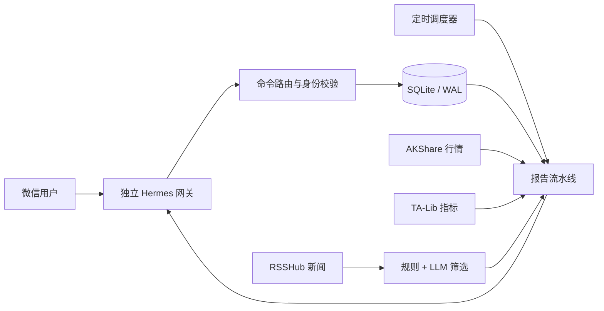

# Stockat · 股小喵 🐾

> 面向个人微信私聊的多用户 A 股盘前信息助手：整理新闻、维护自选、计算网格参考参数，并把每位用户的数据严格隔离。

[](https://github.com/yichen222-smart/Stockat/actions/workflows/ci.yml)
[](https://www.python.org/)
[](LICENSE)

Stockat（股小喵）把分散的 A 股行情、公告和财经资讯整理成简洁的微信盘前消息。它通过 Hermes 接入微信，使用 AKShare 获取行情、TA-Lib 计算指标、RSSHub 汇聚资讯，并可调用大模型完成新闻筛选。

本项目只提供信息整理和参数辅助，不连接券商、不自动下单、不读取账户资金或持仓，也不承诺收益。所有内容仅供学习和研究，不构成投资建议。

## 为什么做这个项目

普通行情软件擅长展示全市场数据，但很难同时满足“只看我的关注”“每天固定时间送达”“多人使用但数据互不可见”和“失败后可安全续传”。Stockat 重点解决这些工程问题：

- 每个微信用户只读取自己的自选、网格记录和报告；
- 报告按用户、栏目记录发送状态，失败重试不会重发已完成部分；
- 新闻、行情或交易日历不可靠时停止输出，不编造数据；
- 微信网关按用户隔离，单个网关故障不阻塞其他用户；
- 网格触发风险条件后停止，而不是继续给出旧参数。

## 核心能力

### 个性化关注

- 添加、暂停、恢复和删除板块或股票；
- 普通股票只跟踪资讯，网格股票额外计算参数和停止条件；
- 支持股票代码和名称输入，歧义名称会要求确认；
- SQLite 按稳定的微信会话身份隔离用户数据。

### 三段式盘前报告

1. **盘前提示**：当天重要市场信息；
2. **你的关注**：板块新闻和股票新闻；
3. **网格参数**：参考价、档位间距、运行区间、停止价和连续成交记录。

交易日从 08:30 起串行发送；非交易日发送轻量休市提醒。报告标明新闻与行情的数据截止时间。

### 网格风险控制

满足任一条件时，整套网格停止：

- 连续买入或卖出达到 5 档；
- 收盘价连续两个交易日位于正常区间同一侧之外；
- 单日收盘价越过极限停止价；
- 出现重大风险公告、停牌、ST 或退市风险；
- 行情或指标数据异常，无法可靠计算。

### 可靠发送

- 每个报告栏目独立记录发送状态；
- 某一栏目失败后，从失败位置继续；
- 已完成用户在同日补跑中自动跳过；
- 用户没有独立发送路由时失败关闭，不回退到其他人的网关；
- 交易日历获取失败且无缓存时停止发送，避免休市日误发。

## 使用示例

```text
你：添加板块：半导体
股小喵：已添加板块：半导体

你：添加网格股票：600036
股小喵：已添加网格股票：600036 招商银行

你：查看我的关注
股小喵：板块：半导体
        股票：600036 招商银行（网格）

你：记录买入：600036
股小喵：已记录买入 1 档。连续买入档数：1
```

常用指令：

| 目标 | 指令示例 |
|---|---|
| 添加普通股票 | `添加股票：600519` |
| 添加网格股票 | `添加网格股票：600036` |
| 查看关注 | `查看我的关注` |
| 查看网格 | `查看 600036 网格` |
| 记录成交 | `记录买入：600036` |
| 暂停早报 | `暂停早报` |
| 临时报告 | `立即生成我的报告` |

完整指令见[用户指南](docs/user-guide.md)，管理员和多用户接入说明见[管理员指南](docs/admin-guide.md)。

## 系统架构



核心分层：

- `app/commands`：微信自然语言指令路由；
- `app/users`：邀请、角色和用户隔离；
- `app/grid`：网格参数与停止条件；
- `app/news`：新闻采集、关联画像和筛选；
- `app/scheduler`：交易日调度、报告构建和断点续传；
- `app/messaging`：Hermes/微信发送适配；
- `app/db`：SQLite 数据模型与迁移。

## 本地运行

要求：Python 3.11–3.13、[uv](https://docs.astral.sh/uv/)；如需测试 RSS 新闻路由，还需要 Docker。

```bash
git clone https://github.com/yichen222-smart/Stockat.git
cd Stockat

uv sync --locked --extra test
cp .env.example .env

# 初始化本地 SQLite
uv run stockat --root . migrate

# 健康检查
uv run stockat --root . health

# 生成报告但不发送微信消息
uv run stockat --root . daily --force --no-send
```

启动本地 RSSHub：

```bash
docker compose -f infra/docker-compose.yml up -d
```

真实微信接入需要分别配置 Hermes 和受保护的环境变量。不要把 `.env`、微信令牌或二维码提交到仓库。

## 测试

```bash
uv run pytest -ra
```

默认测试不访问网络。实时 AKShare/RSSHub 集成测试需要显式开启：

```bash
RUN_LIVE_TESTS=1 uv run pytest tests/integration -ra
```

当前公开基线：36 个单元测试通过，9 个实时集成测试默认跳过。GitHub Actions 会在 Python 3.11 和 3.13 上运行默认测试集。

## 部署

`infra/systemd/` 和 `scripts/` 保留了 Linux 生产化部署参考，包括：

- systemd 服务与定时器；
- 每日备份和恢复；
- 健康检查与日志轮转；
- 多微信网关隔离；
- 发布、回滚和验收脚本。

这些模板默认使用 `/opt/grid-assistant`，部署前应按实际环境审阅并修改。详细说明见[运维手册](docs/operations.md)。

## 数据与隐私

- 不从消息文本推断身份，只接受网关提供的稳定会话身份；
- 管理员默认不能查看普通用户的具体关注、成交记录和个性化报告；
- 示例股票画像仅用于演示新闻关联逻辑，不代表真实用户持仓或建议；
- `.env`、数据库、日志、备份和运行时目录均被 Git 忽略。

## 技术栈

- Python 3.11+
- SQLite / WAL
- AKShare、pandas、NumPy、TA-Lib
- RSSHub
- Hermes / 微信网关
- DeepSeek-compatible API
- pytest、Docker Compose、systemd

## 已知限制

- 行情和新闻质量受第三方数据源影响；
- 微信外部接口不提供端到端幂等编号，极端断电窗口仍可能产生单条重复消息；
- 网格参数基于历史前复权日线，不是未来价格预测；
- 当前不连接券商，也不提供自动交易能力。

## 开源说明

本项目自有代码采用 [MIT License](LICENSE)。Hermes 与 RSSHub 是独立的第三方依赖，分别遵循其自身许可证；本仓库不重新分发它们的完整源码。
